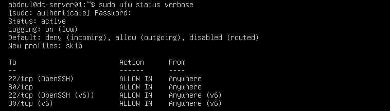
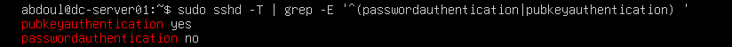
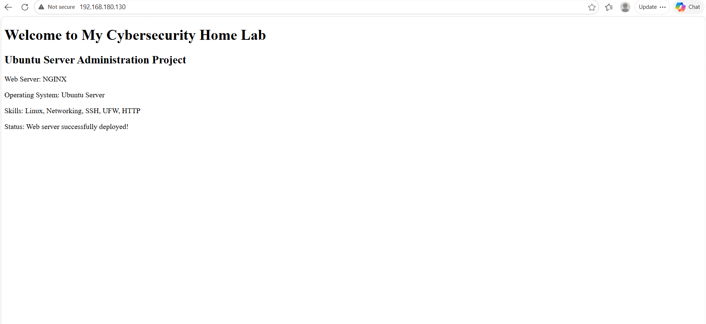
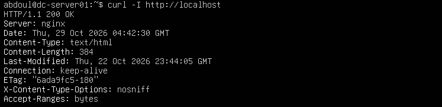
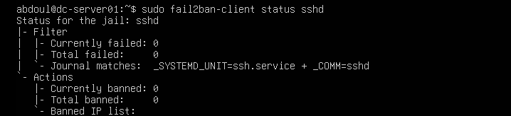
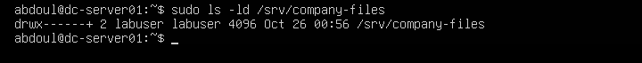
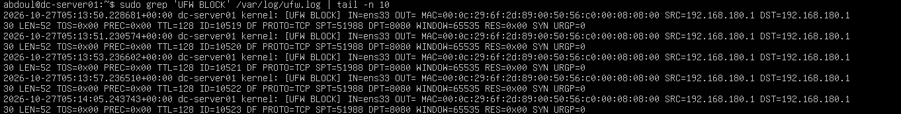
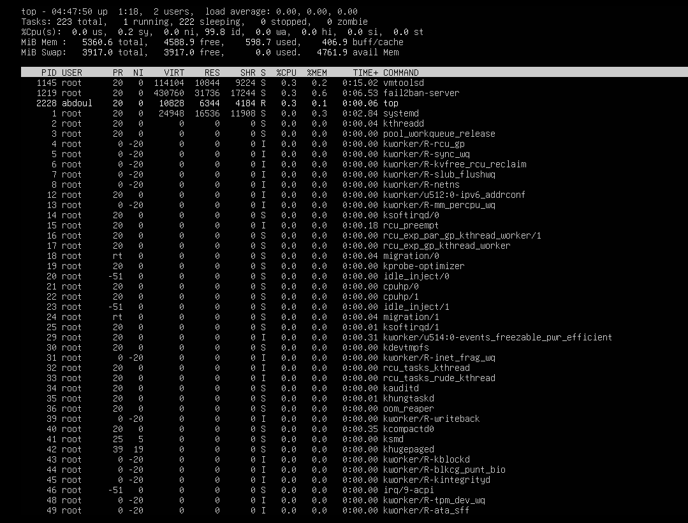
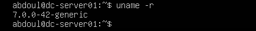
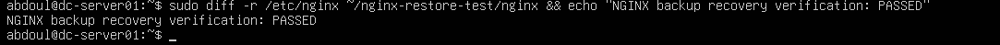

# Ubuntu Server Administration & Cybersecurity Home Lab

## Project Overview

This project demonstrates my hands-on experience with Linux server administration, networking, and cybersecurity using VMware Workstation and Ubuntu Server.

I built and configured a virtual Ubuntu server to practice real-world IT administration and security tasks. My goal was to understand how servers operate, how to protect them from unauthorized access, and how to troubleshoot common problems.

During this project, I configured secure SSH access, managed firewall rules using UFW, implemented Fail2ban protection, deployed an NGINX web server, monitored system logs, managed Linux file permissions, and practiced backup and recovery.

I also performed system updates, investigated security events, and verified that important services continued working after a reboot.

## Technologies Used

- VMware Workstation
- Ubuntu Server 26.04 LTS
- Linux Command Line
- OpenSSH
- UFW Firewall
- Fail2ban
- NGINX Web Server
- Systemd and Journalctl
- Linux File Permissions and ACLs
- Git and GitHub

## Project Objectives

- Build and manage a Linux server in a virtual environment.
- Configure secure remote administration using SSH keys.
- Protect network services with firewall rules.
- Monitor logs and investigate security events.
- Deploy and maintain a web server.
- Manage user accounts and file permissions.
- Perform security updates and system maintenance.
- Create and test system configuration backups.
- Develop practical troubleshooting and cybersecurity skills.

## Network Architecture

I created my cybersecurity home lab using VMware Workstation on a Windows computer.

The Ubuntu Server virtual machine uses VMware NAT networking, allowing my Windows host to communicate with the server.

### Network Configuration

| Component | Configuration |
|---|---|
| Host Operating System | Windows |
| Virtualization Platform | VMware Workstation |
| Guest Operating System | Ubuntu Server 26.04 LTS |
| Server Hostname | dc-server01 |
| Ubuntu Server IP | 192.168.180.130 |
| Windows VMware NAT Adapter | 192.168.180.1 |
| Virtual Network Gateway | 192.168.180.2 |
| Network Mode | NAT |

### Network Services

- **SSH (TCP 22):** Secure remote server administration.
- **HTTP (TCP 80):** NGINX web server access.
- **UFW:** Controls incoming and outgoing network traffic.
- **Fail2ban:** Monitors SSH authentication failures and applies temporary bans when configured thresholds are reached.

### Network Verification

I verified network communication by connecting from Windows to Ubuntu using SSH and accessing my NGINX website through a web browser.

I also tested firewall restrictions by attempting a connection to TCP port 8080. The connection failed, and I confirmed that UFW recorded the blocked traffic in its logs.

## SSH Security and Remote Administration

I configured OpenSSH to securely manage my Ubuntu server from my Windows computer.

### Security Measures Implemented

- Generated an Ed25519 SSH key pair on Windows.
- Configured public-key authentication for remote access.
- Protected my private SSH key with a passphrase.
- Disabled SSH password authentication.
- Verified that SSH key authentication worked successfully.
- Tested password-only authentication and confirmed that it was rejected.
- Verified SSH connectivity after system updates and rebooting.

### Why I Used SSH Keys

SSH keys provide stronger authentication than relying only on passwords. By disabling password authentication, I reduced the risk of unauthorized access through password guessing.

I also learned how to investigate SSH services and verify that port 22 was listening.

## Firewall Configuration Using UFW

I configured Ubuntu's Uncomplicated Firewall (UFW) to control network traffic.

### Firewall Rules

| Setting | Configuration |
|---|---|
| Firewall Status | Active |
| Default Incoming Policy | Deny |
| Default Outgoing Policy | Allow |
| SSH (TCP 22) | Allowed |
| HTTP (TCP 80) | Allowed |
| TCP 8080 | Not allowed |
| Firewall Logging | Enabled |

### Firewall Testing

I tested the firewall by attempting to connect from Windows to Ubuntu using TCP port 8080.

The connection failed because the firewall did not allow that port.

I then investigated the UFW logs and confirmed that the blocked connection attempts were recorded.

This exercise helped me understand firewall rules, network access control, and security log analysis.

## Fail2ban Protection

I installed and configured Fail2ban to provide additional protection against repeated failed SSH login attempts.

### SSH Jail Configuration

- Maximum failed attempts: 5
- Detection window: 10 minutes
- Ban duration: 10 minutes
- Monitored service: SSH

I verified that the SSH jail was active and continued running after the server rebooted.

I also learned how to check failed authentication attempts and banned IP addresses.

**Note:** I verified the Fail2ban configuration and jail status, but did not perform a live IP banning test.

## NGINX Web Server Administration

I installed and configured NGINX on my Ubuntu Server to practice hosting and managing a website.

### Tasks Completed

- Installed NGINX and configured a custom homepage.
- Configured the web server to accept HTTP connections on port 80.
- Accessed the website from my Windows computer using the Ubuntu server's IP address.
- Configured security headers, including `X-Content-Type-Options: nosniff`.
- Disabled NGINX version disclosure using `server_tokens off`.
- Verified that NGINX was running and enabled to start automatically.
- Tested the website using `curl` and confirmed successful HTTP responses.
- Reviewed NGINX access logs and error logs.

### Web Server Security Monitoring

I investigated NGINX access logs to understand how web requests are recorded.

I identified client IP addresses, HTTP request methods, and status codes such as `200 OK` and `304 Not Modified`.

This exercise helped me understand how administrators monitor website activity and troubleshoot web server problems.

## Linux User Management and File Permissions

I practiced managing Linux users, file ownership, permissions, and access control lists (ACLs).

### Tasks Completed

- Created a standard Linux user named `labuser`.
- Verified that the standard user did not have sudo privileges.
- Practiced changing file permissions using `chmod`.
- Managed file ownership using `chown`.
- Created a protected directory for company files.
- Used ACLs to grant a specific user limited access.
- Tested read and write permissions.
- Removed previously granted access and verified that access was denied.

### Least Privilege Security

I practiced the principle of least privilege by giving users only the permissions required for their tasks.

For example, I granted limited access to a confidential company report and later revoked that access.

I verified the results by attempting to access the protected files.

This exercise helped me understand how Linux permissions and ACLs protect sensitive information from unauthorized access.

## Security Monitoring and Log Analysis

I practiced monitoring my Ubuntu server and investigating security-related events using Linux logs.

### Tasks Completed

- Reviewed SSH authentication and administrative activity logs.
- Investigated UFW firewall logs to identify blocked network connections.
- Verified that traffic to TCP port 8080 was blocked and logged.
- Examined NGINX access logs to identify client IP addresses, HTTP requests, and response codes.
- Checked NGINX error logs for troubleshooting information.
- Used `journalctl` to investigate system events and previous shutdowns.
- Identified a previous server shutdown as an administrator-requested action rather than an unexplained crash.
- Monitored CPU, memory, disk usage, and system services.

These exercises helped me understand how system administrators and cybersecurity analysts use logs to investigate activity and troubleshoot problems.

## System Updates and Patch Management

I performed system maintenance to keep my Ubuntu server updated.

### Tasks Completed

- Checked for available software updates.
- Reviewed packages before installing updates.
- Installed available Ubuntu package upgrades.
- Updated the Linux kernel from `7.0.0-38-generic` to `7.0.0-42-generic`.
- Rebooted the server to activate the new kernel.
- Verified the running kernel version after rebooting.
- Confirmed that UFW, Fail2ban, and SSH were still functioning.
- Verified that no further package upgrades were listed.
- Reviewed automatic security update settings.

This exercise taught me why administrators must verify system functionality after installing updates.

## Backup and Recovery

I created and tested backups of my NGINX configuration and website files.

### Backup Tasks

- Created compressed backups using `tar`.
- Backed up the NGINX configuration directory.
- Backed up the website files.
- Verified that the backup archives could be read.
- Extracted both backups into separate test directories.
- Compared the restored files with the original files using `diff`.
- Confirmed that the restored file contents matched the originals.

### What I Learned

I learned that creating a backup is not enough. Administrators must also test whether the backup can be restored successfully.

I performed recovery tests without overwriting the working web server.

**Limitation:** These backups were stored inside the same virtual machine. A future improvement would be to maintain additional backup copies outside the VM.

## Key Skills Developed

Through this project, I gained practical experience in Linux server administration, network troubleshooting, access control, SSH security, firewall management, log analysis, patch management, service monitoring, and backup recovery.

This home lab helped me connect classroom knowledge with hands-on IT and cybersecurity tasks.

## Home Lab Screenshots

The following screenshots document the configurations, security controls, and verification tests I completed during this project.

### 1. UFW Firewall Configuration

### 2. SSH Authentication Security

### 3. NGINX Web Server

### 4. NGINX Security Headers

### 5. Fail2ban SSH Protection

### 6. Linux File Permissions

### 7. Firewall Security Log Analysis

### 8. Linux System Monitoring

### 9. Linux Kernel Update

### 10. Backup and Recovery Verification
